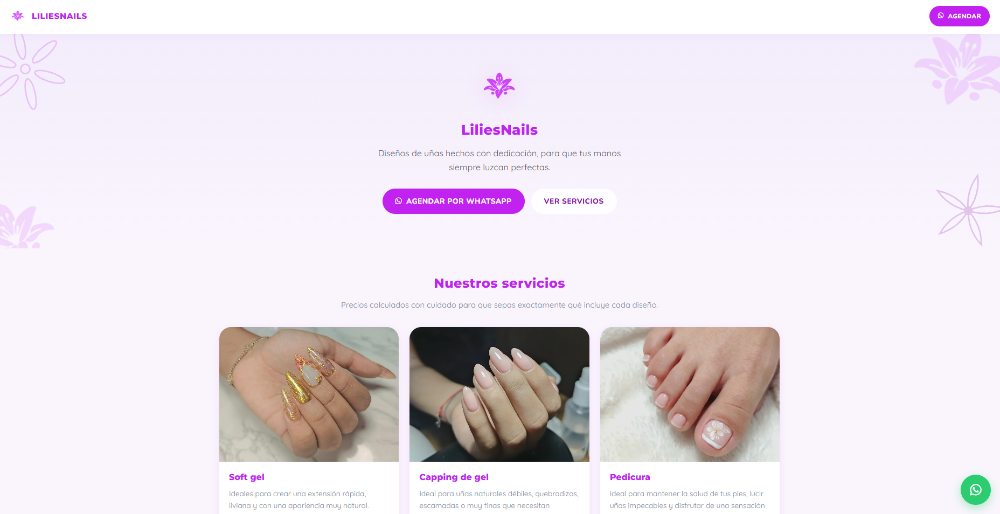

# LiliesNails — Nail Studio Website & Management Panel

A public website and an installable admin app for a nail studio: services with a price calculator, a materials inventory, a photo gallery, client records and an appointment agenda with push-notification reminders. Built with **PHP, MySQL and vanilla JavaScript**, and installable as a **PWA**.

**Live site:** https://liliesnails.ct.ws



## Features

**Public site**
- Services menu for manicure and pedicure with prices.
- Photo gallery carousel of nail designs.
- "Book via WhatsApp" button.
- Installable as an app on the phone (PWA with manifest and service worker).

**Admin panel** (installable PWA)
- **Services:** create, edit, reorder and delete services, with image upload (automatically converted to WebP).
- **Materials inventory:** track materials and link them to services; the final price of a service is calculated from its data.
- **Gallery:** upload and activate or hide photos shown on the public site.
- **Clients and appointments:** client records and a daily/range agenda, with appointments that can include several services and status changes.
- **Push reminders** through OneSignal for upcoming appointments.
- **Backup and restore** of materials and services as a JSON file.
- Site settings and password change.

## Tech stack

PHP 8 (PDO, class-based structure in `src/`) · MySQL / MariaDB · HTML5 · CSS3 · Vanilla JavaScript · Service Worker + Web App Manifest · OneSignal Web Push

## Security

- Passwords stored with bcrypt; login lockout after repeated failed attempts.
- All queries use PDO prepared statements.
- Every API endpoint under `public/api/` requires an authenticated session and answers `401` JSON otherwise.
- Configuration and secrets loaded from environment variables (`.env`, git-ignored); `config/`, `includes/`, `src/` and `database/` blocked from web access.
- Uploaded images are re-encoded server-side.

## Project structure

```
config/       App configuration (reads environment variables)
database/     schema.sql, seed data and incremental migrations
includes/     Bootstrap and shared page headers/footers
public/       Web root: pages, api/ endpoints, assets/, sw.js, manifests
src/          Classes: Auth, Cita, Clienta, Servicio, Material, Galeria, ImagenUtil, OneSignalPush, Database
```

## Getting started (local, XAMPP)

**Requirements:** PHP 8+ with the GD extension and MySQL/MariaDB (`mod_rewrite` enabled).

1. Clone the repository into your web root (for XAMPP: `C:\xampp\htdocs\lilies`).
2. Create an empty database and import `database/schema.sql`. Optionally import `database/seed_datos_actuales.sql` for sample data, and apply the `migracion_*.sql` files if you start from an older schema.
3. Copy `.env.example` to `.env` and fill in your values:

   | Variable | Purpose |
   |---|---|
   | `DB_HOST`, `DB_PORT`, `DB_NAME`, `DB_USER`, `DB_PASSWORD` | Database connection |
   | `APP_ENV` | `local` or `production` |
   | `APP_SECRET` | Long random string used by the app |
   | `ONESIGNAL_APP_ID`, `ONESIGNAL_API_KEY` | Push notifications (optional) |

   If your database provider requires SSL (as Aiven does), place its CA certificate at `config/certs/ca.pem` (git-ignored).
4. Open `http://localhost/lilies/` (the root `.htaccess` forwards requests to `public/`). The admin login is at `/login.php`.

**Admin account.** `schema.sql` creates a default `admin` user. Replace its password hash before any real deployment:

```bash
php -r "echo password_hash('your-new-password', PASSWORD_BCRYPT);"
```

Paste the result into the `INSERT INTO usuarios` line of `database/schema.sql` before importing, or update the row afterwards. You can also change it from the panel (`/cambiar-password.php`).

## Notes

Built for a real business. Code shared with the owner's permission; the live site content and brand belong to the owner.
